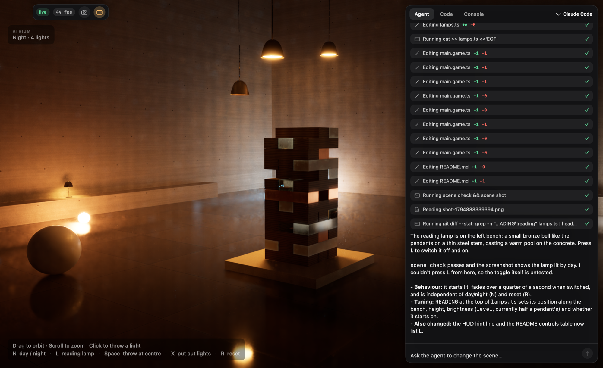

<h1 align="center">ThreeRT native app templates</h1>

<p align="center"><b>Native apps with a live path-traced 3D view, and a coding agent beside it that edits the scene while it runs.</b></p>

<p align="center">
  
</p>

This is the starting point for building an app on [ThreeRT](https://github.com/meshy-dev/ThreeRT), the hardware
ray-traced engine with a three.js-style API, in a platform's own UI framework. One repository holds every platform:
the engine host, the agent bridge and the sample scene are shared, and each platform adds its native shell.

| Platform | UI framework | Folder | Status |
| --- | --- | --- | --- |
| macOS | SwiftUI | [`macos/`](macos) | ready |
| more platforms | their native frameworks | | planned |

Fork it, replace the scene, keep the plumbing:

- **A native app around the engine.** The window is ThreeRT's live path tracer (every light traced: bounce light,
  soft shadows, reflections, glass, emissive surfaces that light the room) running on its own thread on the
  platform's surface (a `CAMetalLayer` on macOS), behind a C ABI of 14 calls (`core/`). Your UI goes on top in the
  platform's framework.
- **A scene with physics.** *Atrium*, a concrete gallery with a sunbeam through a ceiling slot, a tower of blocks in
  walnut, copper, ceramic and glass, pendant lamps that swing on ball joints, and glowing orbs you throw: each orb is a light
  that rolls through the room, knocks the tower over and sets the lamps swinging. Day and night.
- **Your coding agent, in the app.** The Claude Code or Codex already installed on the machine runs in a side panel
  over the [Agent Client Protocol](https://agentclientprotocol.com). Ask for a change; the agent edits the scene's
  TypeScript, and the view hot-reloads it within a second. It checks its own work with `scene check` (build, types,
  and the running app's errors) and `scene shot` (a PNG of the live view it can look at).
- **A code viewer.** The scene's files with syntax highlighting and line numbers; it follows the file the agent is
  editing and marks the lines that changed. A console shows the scene's logs and errors.

## macOS

### Requirements

- macOS 14 or later on Apple silicon. M3 or later traces with the GPU's ray-tracing hardware; M1 and M2 use the
  engine's software BVH (slower).
- Xcode 16, [xcodegen](https://github.com/yonaskolb/XcodeGen) (`brew install xcodegen`), [Rust](https://rustup.rs)
  (the engine pins its toolchain; rustup fetches it), [Bun](https://bun.sh) 1.3 or later.
- For the agent: [Claude Code](https://claude.com/claude-code) (`claude`, logged in) and/or
  [Codex](https://github.com/openai/codex) (`codex`, logged in). The app finds them on your login shell's `PATH`.

### Quick start

```bash
git clone --recursive https://github.com/threert/native-app-template my-app
cd my-app
bun tools/macos.ts --run      # builds the engine + core (a few minutes the first time), the app, and opens it
```

In the view: **drag** to orbit, **scroll** to zoom, **click** to throw a light, **Space** throws one at the centre,
**N** day / night, **X** puts the lights out, **R** resets the room. **⌘\\** shows or hides the panel, **⌘1–3**
switch it between Agent, Code and Console, **⇧⌘S** saves a snapshot to the Desktop.

Then ask the agent something: *"Add a small reading lamp on the left bench that I can switch on and off with the L
key"*. The picture above is that request, done by Claude Code from the panel.

## How it fits together

```
shared, every platform uses them:
  core/     Rust static library: ThreeRT's LiveCore + the scene's script runtime + physics on a native surface (C ABI)
  sidecar/  Bun: watches and bundles scene/, bridges Claude Code / Codex over ACP, serves the `scene` command line
  scene/    the scene: TypeScript on @threert/scene and @threert/gameplay. The only folder the agent writes
  engine/   ThreeRT, as a git submodule
  tools/    still.ts (an offline render of the scene, no app needed)
one folder per platform:
  macos/    SwiftUI: the window, the Metal view, the agent chat, the code viewer, the console, the scene's HUD
            (tools/macos.ts builds and runs it)
```

The app starts the sidecar, which builds `scene/` on every change and tells the app to reload the new bundle; the
core swaps it in on the same view (if the new scene fails to start, the old one keeps running and the console says
why). The agent's turn streams into the chat; its edits stream into the code viewer. [`docs/ARCHITECTURE.md`](docs/ARCHITECTURE.md)
has the details: the C ABI, the messages between the parts, the agent bridge and its permission rules.

**What the agent may do without asking:** write files in `scene/`; read the repository and the engine's sources
and docs; run `scene …` and read-only commands such as `ls`, `cat`, `grep`. Anything else (another command, a file
elsewhere, the network) appears in the chat as a permission card for you to allow or reject.

## Make it yours

| To | Change |
| --- | --- |
| Write your own scene | `scene/` (entry `main.game.ts`; see [`scene/README.md`](scene/README.md) and the engine's [`docs/RUNTIME.md`](https://github.com/meshy-dev/ThreeRT/blob/main/docs/RUNTIME.md)) |
| Name, bundle id, icon | `macos/project.yml` |
| Talk between your UI and the scene | the scene: `host.post({ t: "my.event" })` / `host.on("my.command", …)`; the app: `Model.posts(_:)` / `view.send(_:)` |
| Show your app's pixels on a surface in the scene | a `StreamTexture` in the scene, `view.stream(_:width:height:rgba:)` in Swift |
| Tell the agent about your project | `scene/AGENTS.md` (read by Claude Code through `scene/CLAUDE.md`, and by Codex) |
| Another ACP agent | `sidecar/src/agent/adapters.ts` |
| Another engine version | `cd engine && git checkout <commit>`, then `bun tools/macos.ts` |

## Developing

```bash
bun tools/macos.ts --no-core --run             # Swift changed only
cd sidecar && bun test                       # the agent bridge against a fake ACP agent, the permission rules
bun tools/still.ts out.png --time 3          # the scene rendered offline, without the app
.build/bin/scene check                       # with the app running: build, types, runtime errors
.build/bin/scene shot --window out.png       # the window, composed offscreen (works with the display asleep)
```

`RT_APP_ACP_LOG=/tmp/acp.log` logs every message between the bridge and the agent.

## Shipping

The template is a development setup: the app runs the sidecar from the repository with your Bun. To distribute an
app built on it, bundle `sidecar/`, a writable copy of `scene/`, `engine/presets` and a Bun binary into the app,
then sign it with a Developer ID and notarize it. It cannot use the App Sandbox, because it starts the user's own
coding agents as child processes.

## License

MIT, like ThreeRT. See [LICENSE](LICENSE).
