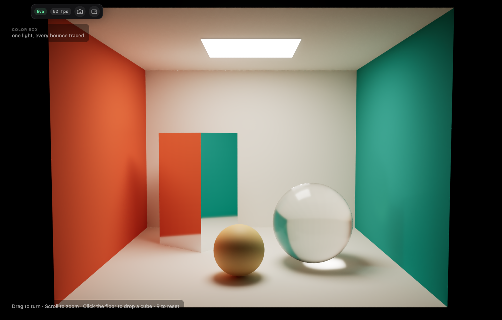

# Color box

The path tracer's hello world: a room open at the front, lit by nothing but one panel in its ceiling. The light
bounces. The coral wall and the teal wall tint the ceiling, the floor and everything between them (global
illumination); the mirror block shows both walls; the glass sphere bends the room and focuses the panel's light into
a bright spot on the floor (a caustic); the shadows are soft because the light is an area, not a point. Every object
is a physics body: click the floor and a cube falls from the ceiling and knocks into things.



## Controls

| input | does |
| --- | --- |
| left-drag | turn around the room |
| wheel | come closer / back off |
| left-click on the floor | drop a cube from under the ceiling |
| R | put everything back, the dropped cubes gone |

## Files

| file | what is in it | tunables at the top |
| --- | --- | --- |
| `main.game.ts` | the room, the light, the objects, the controls, the HUD | `ROOM`, `WALLS`, `PANEL`, `EXPOSURE`, `CUBES` |
| `orbit.ts` | the camera: orbit by dragging, zoom by wheel, click vs drag, the view ray through a point of the picture | drag speed, click slop, smoothing |
| `pool.ts` | the cubes a click drops: made once in setup, parked on a hidden shelf under the floor | |
| `app.json` | the app's words in the agent panel (title, intro, suggested prompts) | |

Units are physical: metres, kilograms, nits for light from surfaces (the panel), EV100 for the exposure. y is up,
the floor's top is y = 0, the room is centred on the origin, its open side (where the camera is) is +z.

## How it works

- **One light, every bounce.** The panel is a `RectAreaLight` (luminance in nits; it is also drawn, as a glowing
  card). The sky is black (`SkyColor` at 0), so everything you see is the panel's light, straight or bounced. The
  walls are matte (`roughness: 0.9`): each bounce carries their colour on.
- **Physics.** The walls are `"fixed"` bodies, the objects and cubes `"dynamic"`. The engine steps the world and moves
  them; the frame script only reads input. Writing `mesh.position` teleports a body (`reset()` does that).
- **Things that come and go are a pool.** Adding a mesh while the scene runs makes the renderer rebuild its scene (a
  hitch), so the cubes are all made in setup and wait on a hidden shelf under the floor; a click moves the next one to
  the ceiling (`Pool.launch`).
- **Input.** The game declares `pointer: "free"`, so the app sends the pointer and keys every frame (`f.input`).
  `Orbit.input` turns them into a drag or a click; `Orbit.pointOn` finds the floor under the pointer. The view ray
  needs the picture's aspect ratio, which the app sends (`view`, `launch` host messages).

## Recipes

**Another object.** In `buildObjects()`, make a mesh and `place()` it: it gets a dynamic body and a spot that R
returns it to. Keep it modest (tens of thousands of triangles in total is fine).

```ts
const gold = new MeshStandardMaterial({ color: 0xffc66b, metalness: 1, roughness: 0.2 });
place(new Mesh(new TorusKnotGeometry(0.25, 0.08, 160, 20), gold), [0.2, 0.35, -0.9]);
```

**The look.** `WALLS` (any colours: saturated ones show the bounce best), `PANEL` (bigger is softer shadows; more
nits is brighter), `EXPOSURE` (lower is brighter). Materials: `roughness` 0 is a mirror, 1 matte; `metalness: 1` for
metals; `MeshPhysicalMaterial` with `transmission: 1` for glass (`ior` 1.5), `clearcoat` for a glaze.

**More light.** Another `RectAreaLight` (a window in a wall: put it in the wall's plane, facing in), a `PointLight`
(candela), or an emissive surface: `new MeshStandardMaterial({ emissive: 0xffb36b, emissiveIntensity: 400 })` (nits)
makes a mesh glow and light the room. Prefer a few large lights to many small ones: every glowing surface is sampled.
Make lights in setup; change their `intensity` when something happens, not a little every frame (each change tells
the denoiser the lighting changed, and the picture gets noisier for a moment).

**A new interaction.** Read a key in `frame` (`if (f.input.pressed("G")) ...`, keys named by their place on a US
keyboard). To act on what the pointer is over, cast the view ray into the physics world:

```ts
const { origin, direction } = orbit.ray(f.camera, f.input.pointer.u, f.input.pointer.v);
const hit = new Raycaster(origin, direction).intersectPhysics()[0]; // { object, point, normal, distance }
if (hit && hit.object.physics?.type === "dynamic") hit.object.applyImpulse(direction.multiplyScalar(20), hit.point);
```

Things that happen over time go in the frame script (`frame(f)`, with `f.dt` / `f.time`); there are no timers. Tell
the player about a new control in the HUD at the end of `frame`.

**The camera.** The `Orbit` options in `setup` (target, starting yaw / pitch / distance, limits); `fov` is the
`PerspectiveCamera`'s first argument.

## A still without the app

From the repository root: `bun tools/still.ts /tmp/box.png --time 2`. An offline render runs physics up to `--time`
but calls the frame script with `dt = 0`, so nothing that follows input or time moves there.
