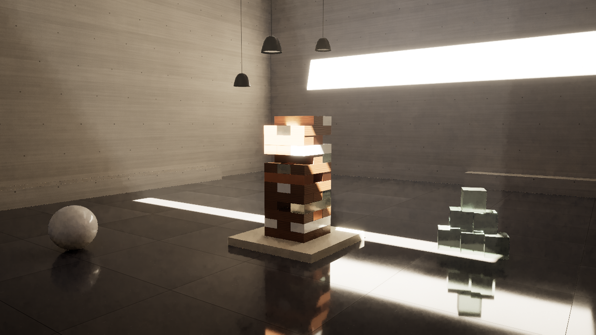

# Atrium

A tall concrete gallery lit by a single slot of sunlight. A tower of walnut, copper, ceramic and glass blocks stands
in the beam; three bronze pendants hang on long cords; the floor is polished dark terrazzo that reflects all of it.
Click and you throw a glowing orb: a real light source that flies, bounces, rolls, knocks the tower down and lights
the room with global illumination as it goes. Press N and the sun sets through the slot; at night the room is lit
only by the pendants and whatever orbs you have thrown.

Everything is procedural: geometry from the SDK, surfaces from small WGSL material functions. No asset files.



## Controls

| input | does |
| --- | --- |
| left-drag | orbit the camera around the tower |
| wheel | come closer / back off |
| left-click (no drag) | throw an orb along the ray through the pointer |
| Space | throw an orb at the centre of the view |
| N | day / night (a 6-second time-lapse through sunset or sunrise) |
| X | put out every orb |
| R | reset the room: tower and cubes rebuilt, lamps still, orbs out |

At most 12 orbs are alight; throwing another retires the oldest (it fades out).

## Modules

| file | what is in it | tunables at the top |
| --- | --- | --- |
| `main.game.ts` | the entry: wires the modules, reads input (drag / click / keys), the HUD | `START` (begin at night, orbs already in the room), keys, click slop |
| `room.ts` | walls, floor, ceiling with its slots, benches; `block()` helper for fixed boxes | `ROOM` size, `SLOTS` (where the sun comes in) |
| `props.ts` | the tower, the glass pyramid, the ceramic sphere; `reset()` | `TOWER`, `LAYERS` (the tower as rows of letters), `CUBES`, `SPHERE` |
| `lamps.ts` | pendants: shade body on a `BallJoint` to a ceiling canopy, emissive diffuser | `PENDANTS` (where, how low), `SWING` |
| `orbs.ts` | the throwable lights: a pool made in setup, thrown / retired / faded | `ORBS` (count, size, speed, brightness), `PALETTE` |
| `lighting.ts` | sun, sky, haze, exposure, day <-> night time-lapse, post-processing | `DAY`, `NIGHT`, `TRANSITION`, `HAZE`, `POST` |
| `camera.ts` | orbit camera (smoothed, kept inside the walls) and the pointer's view ray | `ORBIT` |
| `materials.ts` | every material, and the WGSL functions for concrete, terrazzo, walnut, brushed metal | `CONCRETE`, `STONE`, `WALNUT`, `COPPER`, `CERAMIC`, `GLASS`, `PENDANT` |

Units are physical: metres, kilograms, lux for the sun, nits for emission, EV100 for exposure. y is up, the floor's
top is y = 0, the room is centred on the origin, its front (where the camera starts) is +z.

## How it works (the parts worth knowing before changing them)

- **Physics.** Every visible thing has a body: the room's boxes are `"fixed"`, the blocks, cubes, sphere, lamp shades
  and orbs are `"dynamic"`. The engine steps the world at 60 Hz and moves the objects; no script runs per body per
  frame. Reading `mesh.position` gives the body's pose; writing it teleports the body.
- **Orbs are a pool.** Adding an emissive object or a new material while the scene runs can make the renderer rebuild
  its scene (a hitch). So all 14 orbs (12 + 2 spares fading out) are built in setup, parked on a hidden shelf under the
  floor with `power = 0`. Throwing one moves it to the camera, sets its velocity and fades `power` up; retiring it
  fades `power` down and parks it. Moving bodies and changing `power` are in-place updates.
- **Lights are emissive surfaces.** Orbs are emissive spheres and the pendants' diffusers are emissive discs; the
  path tracer samples emissive triangles as lights, so there are no separate light objects to keep in step.
  Brightness is `emissiveIntensity` in nits.
- **Day <-> night** moves the sun (`setSunAngles`) of a `dynamic` `SkyAtmosphere`, which the live view updates in
  place, and changes the camera's manual exposure with it. The pendants' `power` follows.
- **Input.** The game declares `pointer: "free"`, so the app sends an `input` message every frame and the frame
  script reads `f.input`. A press that moves less than `CLICK_SLOP` before release is a click (throw), otherwise a
  drag (orbit). The view ray needs the picture's aspect ratio: the scene takes it from a `{ t: "view", width,
  height }` host message or from `width` / `height` in the launch params, and assumes 16:9 until then.
- **Materials** multiply a procedural pattern into the material's own `color` / `roughness`, so the colour you set in
  `materials.ts` is still the main knob. Patterns on things that move use mesh UVs (`i.uv`), patterns on the room use
  world position (`i.wp`). Fine detail is computed only for camera hits (`i.depth == 0u`).

## Recipes

**Add a prop.** In `props.ts`, make a mesh and hand it to `place()`, which gives it a dynamic body, a seed for its
material pattern and a home that `reset()` returns it to:

```ts
const vase = new Mesh(new CylinderGeometry(0.12, 0.18, 0.5, 32), m.ceramic);
vase.name = "vase";
place(vase, new Vector3(-2.0, 0.25, -3.0), 0, { mass: 8 });
```

Something that should never move: `scene.add(block("plinth_2", [w, h, d], [x, y, z], m.travertine))` (a fixed box).
Keep it modest: tens of thousands of triangles in total is fine.

**Change the tower.** Edit `LAYERS` in `props.ts`: one string per layer from the bottom, three letters each (W walnut,
K copper, C ceramic, G glass, F frosted, `.` no block). `TOWER.block` sets the block's size.

**Change the time of day.** `DAY.elevation` / `DAY.azimuth` in `lighting.ts` move the sun (lower elevation = longer,
warmer light; below about 25 degrees the ceiling stops it). `DAY.exposure` / `NIGHT.exposure` set the picture's
brightness (EV100: lower is brighter). To start at night, set `START.night = true` in `main.game.ts`. If you move the
sun, look at where the beam lands: `SLOTS` in `room.ts` places the openings it comes through.

**Make the room hazier or clearer.** `HAZE.density` in `lighting.ts` (0 turns the dust off and saves a few ms).

**A new material.** For a plain one, add a `MeshStandardMaterial` / `MeshPhysicalMaterial` to `makeMaterials()` in
`materials.ts` (and to its return value). For a patterned one, write a `MaterialFunction` next to the others: its
`code` is WGSL that changes `o` (`o.base`, `o.roughness`, `o.metallic`, `o.emissive`, `o.normal`); reuse `HELPERS` and
name new helpers `atr_*`. See `../engine/docs/MATERIAL_FUNCTIONS.md` for the inputs (`i.wp`, `i.uv`, `i.custom`, ...).
Make materials in setup only, never per frame.

**Change the orbs.** `ORBS` in `orbs.ts`: `max`, `radius`, `speed`, `nits` (how much light), `restitution` (bounce).
`PALETTE` lists their colours as kelvin numbers or hex strings. Changing `max` changes the pool size; nothing else
needs to change.

**A new interaction.** Input is read in `handleInput()` in `main.game.ts`. Add a key the same way as the others
(`if (input.pressed("G")) ...`, keys named by their US-keyboard position). To act on what the pointer is over, cast
the view ray into the physics world:

```ts
const { origin, direction } = orbit.ray(f.camera, input.pointer.u, input.pointer.v, aspect);
const hit = new Raycaster(origin, direction).intersectPhysics()[0];   // { object, point, normal, distance }
if (hit && hit.object.physics?.type === "dynamic") hit.object.applyImpulse(direction.multiplyScalar(60), hit.point);
```

Things that should happen over time go in the frame script (`frame(f)`, with `f.dt` / `f.time`); there are no timers.
Tell the player about it in `showHud()`.

**Change the camera.** `ORBIT` in `camera.ts`: the target point, the starting yaw / pitch / distance, limits, drag
speed and smoothing, field of view.

## Rendering a still without the app

From the repository root: `bun tools/still.ts /tmp/atrium.png --time 2` renders the default view by day. For night or
for a room with orbs in it, either set `START` in `main.game.ts`, or call the renderer with a room id: the scene reads
`night`, `orbs` or `night+orbs` from it (`threert-render render <bundle> --room night+orbs`). Note that an offline
render runs physics up to `--time` but calls the frame script with `dt = 0`, so time-based fades and the day / night
time-lapse don't advance there; the room-id modes set their end states directly.
